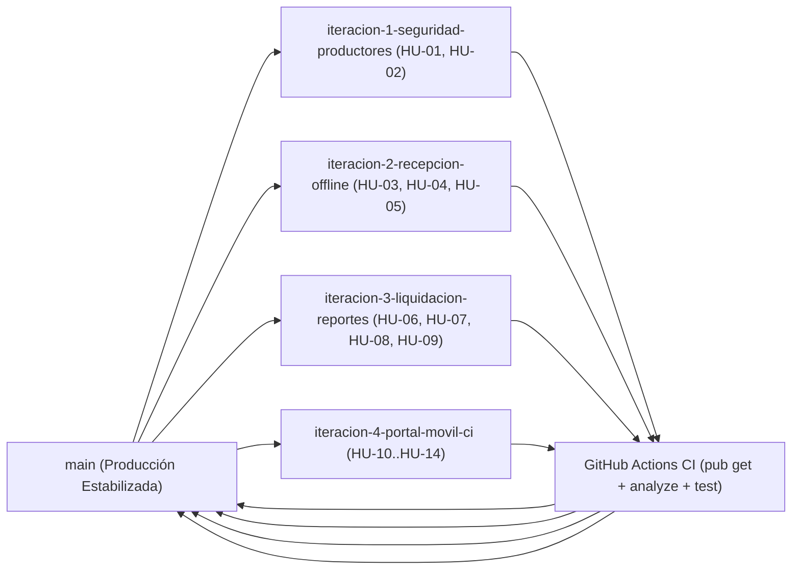

# Tablero Kanban y Trazabilidad XP — Historias de Usuario (`HU-01` a `HU-14`)

> **Proyecto:** Sistema de registro y control de recepción de leche cruda para ASOPROGANUCOTT (Susa, Cundinamarca)  
> **Metodología Ágil:** Extreme Programming (XP) + Integración Continua (`RNF-04`, `CHK-02`)  
> **Workflow CI vinculado:** [.github/workflows/flutter_ci.yml](../.github/workflows/flutter_ci.yml)

---

## Flujo de Ramas XP por Iteración

---

## Columnas del Tablero Kanban (GitHub Projects)

| Columna | Regla de Movimiento |
| :--- | :--- |
| **Backlog XP** | Historia priorizada con criterios de aceptación y trazabilidad `RF`/`RNF`. |
| **En Progreso** | Rama `iteracion-X-*` o `feature/HU-XX` abierta con pruebas XP en construcción. |
| **En Revisión / CI** | Pull Request hacia `main` con `flutter analyze` (0 issues) y `flutter test` verde. |
| **Done (Validado)** | Integrado en `main`, cubierto por pruebas unitarias/E2E y verificado contra el Plan Maestro. |

---

## Matriz Completa de Historias de Usuario (`HU-01` a `HU-14`)

| Código | Historia de Usuario | Rol | Rama XP | Requerimientos | Estado Kanban | Prueba Automatizada |
| :--- | :--- | :--- | :--- | :--- | :--- | :--- |
| **HU-01** | Autenticación segura, RBAC y gestión de usuarios de planta y productores | Admin / Operario | `iteracion-1-seguridad-productores` | `RF-01`, `RF-02`, `RF-03`, `RNF-07` | **Done** | `test/unit/rbac_permissions_test.dart`, `test/widget_test.dart` |
| **HU-02** | Registro de productores con unicidad y consentimiento Habeas Data Ley 1581 | Admin | `iteracion-1-seguridad-productores` | `RF-04`, `RF-05`, `RF-06`, `RF-07`, `RNF-05` | **Done** | `test/unit/producer_validation_test.dart` |
| **HU-03** | Captura rápida de entregas de leche en planta 100% por teclado en `< 10 s` | Operario / Admin | `iteracion-2-recepcion-offline` | `RF-08`, `RF-09`, `RF-10`, `RNF-03` | **Done** | `test/unit/reception_rules_test.dart` |
| **HU-04** | Operación Offline-First en Hive cifrado AES-256 e idempotencia al reconectar | Operario / Admin | `iteracion-2-recepcion-offline` | `RNF-01`, `RNF-03`, `CHK-03` | **Done** | `test/unit/offline_sync_test.dart`, `test/unit/e2e_field_validation_test.dart` |
| **HU-05** | Corrección o anulación auditada pre-liquidación con bitácora inmutable | Admin | `iteracion-2-recepcion-offline` | `RF-11`, `RNF-06`, `RNF-07` | **Done** | `test/unit/reception_rules_test.dart` |
| **HU-06** | Configuración histórica de tarifas por litro sin alterar períodos previos | Admin | `iteracion-3-liquidacion-reportes` | `RF-12` | **Done** | `test/unit/settlement_calculator_test.dart` |
| **HU-07** | Cierre quincenal automático y atómico sin doble liquidación | Admin | `iteracion-3-liquidacion-reportes` | `RF-13`, `RNF-04`, `RNF-06`, `CHK-04` | **Done** | `test/unit/settlement_calculator_test.dart`, `test/unit/e2e_field_validation_test.dart` |
| **HU-08** | Comprobante interno PDF numerado con huella SHA-256 Ley 527 de 1999 | Admin / Productor | `iteracion-3-liquidacion-reportes` | `RF-14`, `RF-15` | **Done** | `test/unit/settlement_calculator_test.dart`, `test/unit/e2e_field_validation_test.dart` |
| **HU-09** | Reportes por productor, métricas en tiempo real y exportación CSV/PDF + auditoría | Admin / Operario | `iteracion-3-liquidacion-reportes` | `RF-16`, `RF-17`, `RF-18`, `RNF-07` | **Done** | `test/unit/report_service_test.dart` |
| **HU-10** | Aislamiento estricto de datos personales y entregas por UID en móvil | Productor | `iteracion-4-portal-movil-ci` | `RF-19`, `RNF-05` | **Done** | `test/unit/producer_portal_test.dart` |
| **HU-11** | Consulta cronológica de solo lectura de entregas diarias con filtros en móvil | Productor | `iteracion-4-portal-movil-ci` | `RF-20`, `RF-21`, `RNF-02` | **Done** | `test/unit/producer_portal_test.dart` |
| **HU-12** | Consulta móvil de liquidaciones quincenales cerradas y descarga PDF | Productor | `iteracion-4-portal-movil-ci` | `RF-22` | **Done** | `test/unit/producer_portal_test.dart` |
| **HU-13** | Alertas push FCM HTTP v1 ante entrega, cierre quincenal, liquidación y pago | Productor | `iteracion-4-portal-movil-ci` | `RF-23`, `CHK-05` | **Done** | `test/unit/producer_portal_test.dart`, `test/unit/e2e_field_validation_test.dart` |
| **HU-14** | Emisor administrativo de comunicados masivos y bandeja de avisos en móvil | Admin / Productor | `iteracion-4-portal-movil-ci` | `RF-24` | **Done** | `test/unit/producer_portal_test.dart` |

---

## Importación Directa en GitHub Projects

El archivo [kanban_github_projects.csv](kanban_github_projects.csv) contiene los registros listos para importar al tablero Kanban de **GitHub Projects** o sincronizar mediante la plantilla [.github/ISSUE_TEMPLATE/historia_usuario_xp.md](../.github/ISSUE_TEMPLATE/historia_usuario_xp.md).
