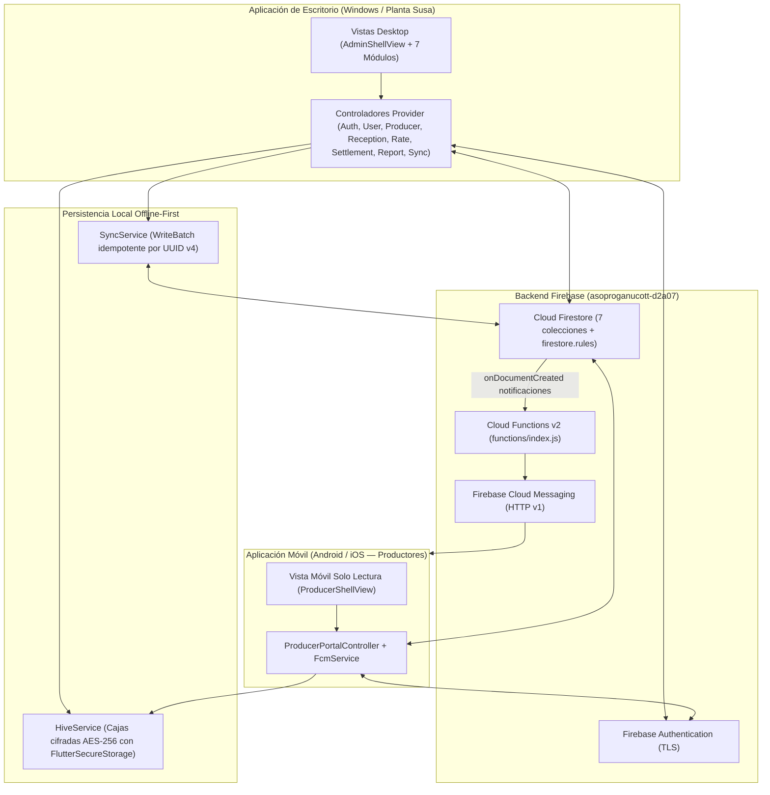

# Manual Técnico — Sistema ASOPROGANUCOTT (`CHK-08`)

> **Proyecto de grado:** *Sistema de registro y control de recepción de leche cruda para la asociación lechera ASOPROGANUCOT en el municipio de Susa (Valle de Ubaté, Cundinamarca)*  
> **Arquitectura:** Modelo–Vista–Controlador (`MVC`) · Cliente–Servidor · Offline-First (`Hive` AES-256 + `Firebase`)  
> **Proyecto Firebase:** `asoproganucott-d2a07` (Cloud Firestore `nam5`, Firebase Auth, Firebase Cloud Messaging HTTP v1)

---

## 1. Arquitectura General del Sistema



---

## 2. Estructura del Proyecto (`lib/`, `functions/`, `test/`)

### 2.1 Capa de Modelos (`lib/models/`)
- `user_model.dart`: `UserModel` (`uid`, `nombreCompleto`, `documento`, `correo`, `telefono`, `rol`, `activo`, `fcmTokens`, `fechaCreacion`, `ultimoAcceso`) con propiedades RBAC (`isAdmin`, `isOperario`, `isProductor`, `canAccessDesktopAdmin`).
- `producer_model.dart`: `ProducerModel` (`productorId`, `uidUsuario`, `codigoAsociado`, `cedula`, `nombres`, `apellidos`, `telefono`, `nombreFinca`, `vereda`, `estado`, `aceptoHabeasData`, `fechaAutorizacionDatos`, `autorizadoPorUid`).
- `milk_rate_model.dart`: `MilkRateModel` (tarifas históricas por vigencia sin sobrescritura de períodos cerrados).
- `milk_reception_model.dart`: `MilkReceptionModel` (`recepcionId` UUID v4, `litros`, `fechaEntrega`, `horaEntrega`, `jornada` `MANANA`/`TARDE`, `syncStatus`, `isSynced`, `liquidacionId`, `anulado`, `motivoAnulacion`).
- `settlement_model.dart`: `SettlementModel` (`liquidacionId`, `numeroComprobante`, `hashIntegridad`, `estadoPago`, `fechaPago`, `observacionPago`).
- `app_notification_model.dart`: `AppNotificationModel` (`ENTREGA`, `CIERRE_QUINCENA`, `LIQUIDACION`, `PAGO`, `COMUNICADO`, `RECTIFICACION`).
- `audit_log_model.dart`: `AuditLogModel` (bitácora inmutable `auditoria_logs`).

### 2.2 Capa de Servicios (`lib/core/services/`)
- `firebase_user_service.dart`: autenticación por correo o cédula (`signInWithIdentifier`), gestión CRUD y creación secundaria de cuentas sin cerrar sesión (`SecondaryUserCreator`).
- `hive_service.dart`: inicialización de cajas Hive y cifrado AES-256 (`HiveAesCipher`) respaldado en `FlutterSecureStorage`.
- `master_cache_service.dart`: sincronización local del padrón activo y tarifa vigente para operar 100% sin red.
- `sync_service.dart`: registro local prioritario (`registerReceptionOfflineFirst`) y subida idempotente por lotes (`WriteBatch`, `maxBatchSize = 400`).
- `producer_service.dart`: unicidad estricta de `cedula` y `codigoAsociado`, validación obligatoria Ley 1581 de 2012, vinculación automática con cuenta móvil y `findProducerForUser`.
- `reception_service.dart`: captura diaria, alerta de duplicados (`DuplicateReceptionException`), corrección/anulación auditada por `ADMIN`, bloqueo post-liquidación, alerta local `ENTREGA` y `listForProducer`.
- `rate_service.dart`: configuración de nuevas vigencias históricas de tarifa por litro.
- `settlement_calculator.dart`: motor determinista en punto fijo entero (`thousandths`, `rateCents`), consecutivo `COMP-YYYY-XXXX` y huella SHA-256 Ley 527 de 1999 (`computeIntegrityHash`).
- `settlement_service.dart`: cierre quincenal atómico y confirmación de pago `PENDIENTE -> PAGADA`.
- `settlement_pdf_service.dart`: comprobantes internos de pago en PDF.
- `report_service.dart` y `report_export_service.dart`: estadísticas consolidadas, bitácora `auditoria_logs`, CSV UTF-8 con BOM y PDF administrativo.
- `notification_service.dart`: bandeja móvil aislada, comunicados institucionales (`COMUNICADO`) y solicitudes de rectificación Ley 1581 de 2012 (`RECTIFICACION`).
- `fcm_service.dart`: encapsulamiento seguro por plataforma (`!kIsWeb && (Platform.isAndroid || Platform.isIOS)`) con soporte de suscripción a tópicos y escucha en primer plano.

### 2.3 Capa de Controladores (`lib/controllers/`)
- `auth_controller.dart`, `user_controller.dart`, `sync_controller.dart`, `producer_controller.dart`, `reception_controller.dart`, `rate_controller.dart`, `settlement_controller.dart`, `report_controller.dart`, `producer_portal_controller.dart`.

### 2.4 Capa de Vistas (`lib/views/`)
- `shared/`: `login_view.dart` (escritorio 2 columnas con `CowBalloon3DWidget` + móvil `ModernWaveHeader`), `widgets/dairy_loader.dart` (`DairyLoader`, `AsoproganucotCurtain`), `widgets/design_system_widgets.dart`.
- `desktop/`: `admin_shell_view.dart`, `dashboard_module_view.dart`, `reception_module_view.dart`, `producers_module_view.dart`, `settlements_module_view.dart`, `rates_module_view.dart`, `reports_module_view.dart`, `users_module_view.dart`.
- `mobile/`: `producer_shell_view.dart` (`Resumen`, `Mis Entregas`, `Liquidaciones y Avisos`, perfil + rectificación Ley 1581).

---

## 3. Modelo de Datos en Cloud Firestore y Hive Offline

### 3.1 Colecciones Cloud Firestore y Reglas (`firestore.rules`)

| Colección | Control de Acceso (`firestore.rules`) | Regla de Integridad / Inmutabilidad |
| :--- | :--- | :--- |
| `usuarios` | Lectura para resolver cédula en login; escritura solo `ADMIN` o propietario (`request.auth.uid == uid`). | `delete: if false` |
| `productores` | Lectura `ADMIN`/`OPERARIO` o `uidUsuario == request.auth.uid`; escritura solo `ADMIN`. | Exige `aceptoHabeasData == true` (`Ley 1581/2012`). |
| `tarifas_leche` | Lectura autenticada; creación/ajuste solo `ADMIN`. | Precio, fecha de inicio y creador inmutables tras crear. |
| `recepciones_leche` | Lectura `ADMIN`/`OPERARIO` o productor propietario (`isProducerOwner`); escritura `ADMIN`/`OPERARIO`. | Bloqueo total de edición una vez `liquidacionId != null` (`RNF-06`). |
| `liquidaciones` | Lectura `ADMIN`/`OPERARIO` o productor propietario (`isProducerOwner`); creación solo `ADMIN`. | Montos y totales inmutables; `ADMIN` solo transiciona `PENDIENTE -> PAGADA`. |
| `notificaciones` | Lectura `ADMIN`/`OPERARIO` o avisos del propio productor / comunicados generales (`null`). | Productor solo puede crear `RECTIFICACION` y actualizar el campo `leida`. |
| `auditoria_logs` | Lectura `ADMIN`/`OPERARIO`; creación autenticada. | **Append-only estricto** (`update, delete: if false`). |

### 3.2 Índices Compuestos (`firestore.indexes.json`)
- `recepciones_leche`: `(productorId ASC, fechaEntrega DESC)` y `(liquidacionId ASC, fechaEntrega ASC)`.
- `liquidaciones`: `(productorId ASC, fechaLiquidacion DESC)` y `(estadoPago ASC, fechaLiquidacion DESC)`.
- `notificaciones`: `(destinoProductorId ASC, fechaEnvio DESC)`.

### 3.3 Cajas Locales Hive (`AppConstants`)
- Cajas sin cifrado de sesión/usuarios: `users_box`, `session_box`.
- Cajas cifradas AES-256 (`HiveAesCipher`): `deliveries_box`, `producers_box`, `rates_box`, `settlements_box`, `notifications_box`.

---

## 4. Fuentes Locales y Recursos Offline
- Tipografía oficial **`Inter`** empaquetada localmente en `assets/fonts/` (`Inter-Regular.ttf` 400, `Inter-Medium.ttf` 500, `Inter-SemiBold.ttf` 600, `Inter-Bold.ttf` 700, `Inter-ExtraBold.ttf` 800) y declarada en `pubspec.yaml` con `GoogleFonts.config.allowRuntimeFetching = false;` en `lib/main.dart`.
- Logotipo oficial circular en `assets/images/` e íconos nativos generados para Android, iOS, macOS, Web y Windows.
- Modelo 3D GLB en `assets/models/spot_holstein_cow.glb`.

---

## 5. Cloud Functions FCM HTTP v1 (`functions/`)
El archivo `functions/index.js` define el disparador `onNotificationCreated` sobre `notificaciones/{notificacionId}` para enviar notificaciones push mediante FCM HTTP v1 ante los eventos: `ENTREGA`, `CIERRE_QUINCENA`, `LIQUIDACION`, `PAGO` y `COMUNICADO`.

```bash
# Instalación y despliegue de reglas, índices y funciones en Firebase
firebase deploy --only firestore:rules,firestore:indexes
cd functions && npm install && cd ..
firebase deploy --only functions
```

---

## 6. Comandos de Compilación, Análisis y CI
- **Análisis estático:** `flutter analyze` (`0` advertencias/errores exigidos).
- **Suite de pruebas XP:** `flutter test` (`test/unit/` y `test/widget_test.dart`).
- **Ejecución Windows Desktop:** `flutter run -d windows`.
- **Compilación Android APK:** `flutter build apk --release`.
- **Integración Continua:** automatizada en `.github/workflows/flutter_ci.yml`.
