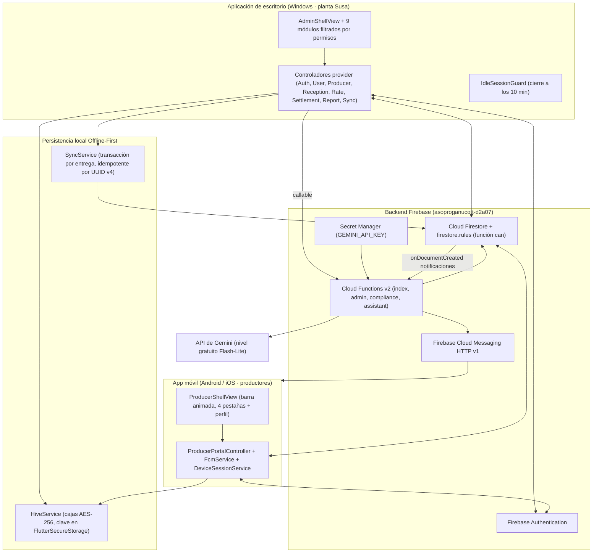

# Manual Técnico — Sistema ASOPROGANUCOTT (`CHK-08`)

> **Proyecto de grado:** *Sistema de registro y control de recepción de leche cruda para la asociación lechera ASOPROGANUCOT en el municipio de Susa (Valle de Ubaté, Cundinamarca)*
> **Arquitectura:** Modelo–Vista–Controlador (`MVC` con `provider`) · Cliente–Servidor · Offline-First (`Hive` AES-256 + `Firebase`)
> **Proyecto Firebase:** `asoproganucott-d2a07` (Cloud Firestore, Firebase Auth, Cloud Functions v2 en Node.js 22, Firebase Cloud Messaging HTTP v1, Secret Manager)

---

## 1. Arquitectura general



- **Escritorio** (Windows; también compila en macOS/Linux): administradores y operarios.
- **Móvil** (Android/iOS): portal del productor, solo lectura.
- En Windows no existe el SDK nativo de Cloud Functions; las llamadas *callable* usan el protocolo HTTPS implementado en `lib/core/services/firebase_callable.dart`.

---

## 2. Estructura del proyecto

```
lib/
  controllers/        Estado de la app (ChangeNotifier + provider)
  core/
    constants/        AppConstants (nombres de cajas Hive, colecciones, tópicos)
    security/         permissions.dart (árbol de permisos)
    services/         Lógica de negocio y acceso a datos
    theme/            app_theme.dart (sistema visual "Pradera")
    utils/            formatters.dart, input_rules.dart
  models/             Modelos de datos
  views/
    desktop/          Shell de administración y módulos (+ subcarpetas por módulo)
    mobile/           Portal del productor (producer_shell_view.dart + producer/)
    shared/           Login y widgets compartidos
functions/            Cloud Functions (Node.js 22) + pruebas con emulador
integration_test/     Pruebas de integración contra Firebase
test/                 Pruebas unitarias y de widgets
```

### 2.1 Modelos (`lib/models/`)

- `user_model.dart`: `UserModel` (`uid`, `nombreCompleto`, `documento`, `correo`, `telefono`, `rol`, `activo`, `permisos`, `fcmTokens`, `fechaCreacion`, `ultimoAcceso`) con utilidades RBAC (`isAdmin`, `isOperario`, `isProductor`, `can(modulo, accion)`).
- `producer_model.dart`: `ProducerModel` (`productorId`, `uidUsuario`, `codigoAsociado`, `cedula`, `nombres`, `apellidos`, `telefono`, `nombreFinca`, `vereda`, `estado`, `aceptoHabeasData`, `fechaAutorizacionDatos`, `autorizadoPorUid`, `soporteAutorizacion`).
- `privacy_notice.dart`: aviso de privacidad (`configuracion/privacidad`).
- `milk_rate_model.dart`: tarifas históricas por vigencia.
- `milk_reception_model.dart`: entrega (`recepcionId` UUID v4, `litros`, `fechaEntrega`, `horaEntrega`, `jornada` `MANANA`/`TARDE`, `syncStatus`, `isSynced`, `liquidacionId`, `anulado`, `motivoAnulacion`).
- `settlement_model.dart`: liquidación (`liquidacionId`, `numeroComprobante`, `hashIntegridad`, `estadoPago`, `fechaPago`, `observacionPago`).
- `app_notification_model.dart`: avisos (`ENTREGA`, `CIERRE_QUINCENA`, `LIQUIDACION`, `PAGO`, `COMUNICADO`, `RECTIFICACION`).
- `audit_log_model.dart`: evento de `auditoria_logs`.

### 2.2 Servicios (`lib/core/services/`)

| Servicio | Responsabilidad |
| :--- | :--- |
| `firebase_user_service.dart` | Inicio de sesión por correo o cédula (`signInByDocument`), alta y edición de usuarios mediante las funciones `adminCreateUser` / `adminUpdateUser`, restablecimiento de contraseña. |
| `firebase_callable.dart` | Cliente HTTPS *callable* para plataformas sin SDK de Functions (Windows). |
| `device_session_service.dart` | Sesión única en móvil (ver 6.2). |
| `hive_service.dart` | Cajas Hive y cifrado AES-256 (`HiveAesCipher`) con clave en `FlutterSecureStorage`. |
| `master_cache_service.dart` | Caché local del padrón activo y la tarifa vigente para operar sin red. |
| `sync_service.dart` | Registro local prioritario y subida idempotente; cada entrega se crea junto a su versión de auditoría en una transacción. |
| `firestore_audit.dart` | Escribe versión y evento de auditoría en la misma transacción. |
| `producer_service.dart` | Unicidad de cédula y código, consentimiento Ley 1581, vinculación con cuenta móvil. |
| `reception_service.dart` | Captura, alerta de duplicados (`DuplicateReceptionException`), corrección y anulación auditadas, bloqueo post-liquidación. |
| `rate_service.dart` | Publicación de nuevas vigencias de tarifa (cierra la anterior). |
| `finance_config_service.dart` | Parámetros `configuracion/finanzas`: `precioVentaLitro` y `costoOperativoMensual`. Solo alimentan las proyecciones financieras; no intervienen en la liquidación. |
| `settlement_calculator.dart` | Motor determinista en punto fijo entero, períodos quincenales, consecutivo `COMP-YYYY-XXXX` y huella SHA-256 (`computeIntegrityHash`). |
| `settlement_service.dart` | Previsualización y cierre (vía `closeMilkSettlements`), confirmación de pago `PENDIENTE → PAGADA`. |
| `settlement_pdf_service.dart` | Desprendible de pago individual y reporte consolidado de quincena en PDF. |
| `report_service.dart`, `report_export_service.dart` | Catálogo de reportes (consolidado, resumen por productor, liquidaciones y pagos, comparativo de jornadas, productores sin entregas, correcciones y anulaciones) y su exportación. |
| `audit_query_service.dart`, `activity_presenter.dart` | Consulta paginada de `auditoria_logs` y presentación de la actividad de usuarios (tipo de acción, módulo, color, cambios campo a campo). |
| `file_export_service.dart` | Exportación común a PDF, Excel y CSV, guardado y compartir (ver sección 8). |
| `forecast_service.dart` | Pronóstico estadístico a 5 meses (ver sección 7). |
| `assistant_service.dart` | Cliente del asistente IA (función `askAssistant`): historial de 8 mensajes, máximo 600 caracteres por pregunta, espera de 20 s entre preguntas, tiempo límite de 60 s. |
| `broadcast_service.dart` | Comunicados (título 3–80, mensaje 5–500 caracteres), historial y eliminación. |
| `notification_service.dart` | Bandeja del productor, marcado como leído, borrado individual y masivo, solicitudes `RECTIFICACION`. |
| `fcm_service.dart` | FCM solo en Android/iOS; suscripción al tópico `asoproganucott_comunicados`. |
| `voice_service.dart` | Lectura en voz alta (`flutter_tts`) en Recepción, tolerante a fallos si no hay motor de voz. |

### 2.3 Controladores (`lib/controllers/`)

`auth_controller.dart`, `user_controller.dart`, `sync_controller.dart`, `producer_controller.dart` (incluye los ordenamientos del padrón), `reception_controller.dart`, `rate_controller.dart`, `settlement_controller.dart`, `report_controller.dart`, `producer_portal_controller.dart` (incluye las preferencias del recorrido de bienvenida).

### 2.4 Vistas (`lib/views/`)

**Compartidas (`shared/`)**
- `login_view.dart`: ingreso con correo o documento, recordar acceso, recuperación por correo.
- `widgets/pro_ui.dart`: kit de componentes del escritorio — `PageHeader`, `Panel`, `StatItem`/`StatStrip`, `StatusBadge`, `EmptyState`, `AppSearchField`, `LabeledField`, `AppTextField`, `AppDialog`, `ExportButton`, `InitialsAvatar`, `DataHeaderCell`, y las funciones `confirmAction()`, `showAppToast()` y `showExportFormatPicker()`.
- `widgets/app_date_range_picker.dart`: selector de rango con atajos (Hoy, Ayer, Últimos 7 días, Esta quincena, Quincena anterior, Este mes, Mes anterior, Últimos 30 días, Últimos 90 días, Este año); en anchos menores a 640 px se abre como hoja inferior y en escritorio como ventana flotante de dos meses. Incluye `AppDateField` para una sola fecha.
- `widgets/app_select.dart`: listas desplegables con búsqueda.
- `widgets/idle_session_guard.dart`: cierre por inactividad (ver 6.1).
- `widgets/privacy_notice_view.dart`, `dairy_loader.dart`, `cow_balloon_3d_widget.dart`, `ui_kit.dart`, `design_system_widgets.dart`.

**Escritorio (`desktop/`)**

`admin_shell_view.dart` organiza el menú en grupos y asigna atajos fijos. Un módulo solo se muestra si `user.can(<módulo>, ver)`:

| Grupo | Módulo | Atajo | Permiso | Vista principal / subcarpeta |
| :--- | :--- | :--- | :--- | :--- |
| Operación | Inicio | `Ctrl+1` | `dashboard` | `dashboard_module_view.dart`, `dashboard/` |
| Operación | Recepción de Leche | `Ctrl+2` | `recepcion` | `reception_module_view.dart`, `reception/` |
| Operación | Productores | `Ctrl+3` | `productores` | `producers_module_view.dart`, `producers/` |
| Operación | Liquidaciones | `Ctrl+4` | `liquidaciones` | `settlements_module_view.dart`, `settlements/` |
| Gestión | Tarifas por Litro | `Ctrl+5` | `tarifas` | `rates_module_view.dart`, `rates/` |
| Gestión | Reportes y Auditoría | `Ctrl+6` | `reportes` | `reports_module_view.dart`, `reports/` |
| Gestión | Comunicados | `Ctrl+7` | `comunicados` | `communications_module_view.dart`, `communications/` |
| Gestión | Usuarios | `Ctrl+8` | `usuarios` | `users_module_view.dart`, `users/` |
| Inteligencia | Asistente IA | `Ctrl+9` | `asistente` | `assistant_module_view.dart`, `assistant/` |

La barra superior muestra la ruta, el contador de entregas por sincronizar, el estado de conexión, el reloj y el acceso **Preguntar a la IA**.

Detalles por módulo:
- **Recepción** (`reception/`): `quick_capture_bar.dart` (captura por teclado con alerta de duplicado y voz), `reception_spreadsheet.dart` (planilla tipo hoja de cálculo con dos columnas por día, navegación con flechas/Tab/Inicio/Fin/RePág/AvPág, edición con Enter/F2, anulación con Supr), `reception_grid_logic.dart` (reglas de edición y motivos automáticos de auditoría: *"Corrección en planilla: X L → Y L"*, *"Anulación en planilla: …"*), `reception_records_table.dart` (tabla de registros con corrección en línea), `reception_export.dart`.
- **Productores** (`producers/`): `producer_form_wizard.dart` (asistente de 4 pasos: datos personales, finca, autorización Ley 1581, revisión), `producer_table.dart` (filtros y ordenamientos: más recientes, más antiguos, más/menos leche, nombre, código), `producer_detail_panel.dart`, `producer_app_access_dialog.dart`, `producer_directory_export.dart`.
- **Liquidaciones** (`settlements/`): `settlements_overview.dart` (quincena en curso y quincenas cerradas), `close_quincena_wizard.dart` (cierre en 3 pasos: elegir quincena con verificaciones, revisar productores con exclusión, confirmar), `settlement_period_detail.dart`, `daily_matrix_table.dart` (matriz productor × día), `settlement_actions.dart` (registrar pago, ver/descargar/compartir comprobante), `settlement_exports.dart` (PDF, Excel de 4 hojas, CSV).
- **Tarifas** (`rates/`): `new_rate_form.dart`, `rate_panels.dart`, `finance_params_form.dart`.
- **Reportes** (`reports/`): `report_catalog_tab.dart`, `report_preview_table.dart`, `activity_tab.dart`, `activity_feed.dart`, `activity_widgets.dart`.
- **Usuarios** (`users/`): `user_table.dart`, `user_form_dialog.dart` (4 pasos: datos, rol, permisos, revisar), `permission_tree_editor.dart`.
- **Comunicados** (`communications/`): `compose_form.dart` (con vista previa en celular), `broadcast_history.dart`.
- **Asistente** (`assistant/`): `chat_widgets.dart`, `markdown_lite.dart`.

**Móvil (`mobile/`)**
- `producer_shell_view.dart`: barra inferior animada (`animated_bottom_navigation_bar`) con **Inicio**, **Mis entregas**, **Liquidaciones**, **Avisos** y botón central de **Perfil**; contador de avisos no leídos.
- `producer/producer_tour.dart`: recorrido de bienvenida (`tutorial_coach_mark`) de 6 pasos; se marca como visto en `shared_preferences` (`tour_done_<uid>`) en el momento de mostrarse y se puede repetir desde el perfil.
- `producer/home_tab.dart`: carrusel de indicadores con avance automático cada 4 s, gráfica 7/30 días, quincena en curso, última liquidación.
- `producer/deliveries_tab.dart`, `delivery_calendar.dart`: calendario mensual deslizable con totales por jornada y detalle por día.
- `producer/settlements_tab.dart`, `settlement_detail_page.dart`: liquidaciones, vista previa del desprendible (`printing`) y descarga/compartir.
- `producer/notices_tab.dart`: avisos con filtro de no leídos, marcar todo como leído, borrar uno (deslizar, con deshacer) y borrar todos.
- `producer/profile_tab.dart`: datos, finca, Habeas Data, solicitud de corrección, repetir recorrido, cerrar sesión.
- `producer/mobile_kit.dart`: componentes visuales del portal.

### 2.5 Diseño (`lib/core/theme/app_theme.dart`) y reglas de entrada

Sistema visual **"Pradera"** con tipografía **Inter** empaquetada localmente (`assets/fonts/`, sin descarga en tiempo de ejecución).

| Token | Color | Uso |
| :--- | :--- | :--- |
| `brand` | `#0F766E` | Verde azulado institucional (botones, encabezados) |
| `brandDeep` / `brandInk` | `#0B3B37` / `#082826` | Menú lateral y fondos oscuros |
| `brandSoft` | `#E7F5F2` | Fondos suaves de marca |
| `accent` | `#E59E0B` | Ámbar lácteo (jornada tarde, destacados) |
| `canvas` / `surface` | `#F4F6F7` / `#FFFFFF` | Fondo de página / tarjetas |
| `textPrimary` / `textSecondary` | `#0F1B1E` / `#4B5B61` | Texto |
| `success` / `warning` / `danger` / `info` | `#059669` / `#D97706` / `#DC2626` / `#2563EB` | Estados semánticos |

Series de gráficas en orden fijo: `brand`, `accent`, `#4F6BED`, `#E15D7A`, `#7C8B91`. Radios: tarjeta 10, control 8, insignia 6.

`lib/core/utils/input_rules.dart` centraliza las reglas de captura:
- `ThousandsInputFormatter`: formato colombiano mientras se digita (punto de miles, coma decimal; un punto al final se convierte en coma decimal; sin ceros a la izquierda; recorte de decimales). Litros: 2 decimales, máximo `5.000 L`. Dinero: hasta `999.999.999`.
- `FieldLimits`: nombre 40, nombre completo 80, documento 5–12, celular 10 (`3xxxxxxxxx` o `60xxxxxxxx`), correo 80, contraseña 64 (mínimo 8 con letras y números), código 12, finca 60, vereda 40, texto corto 120, texto largo 500, título 80, búsqueda 60, mensaje al asistente 600, precio por litro hasta 99.999.
- Filtros contra caracteres repetidos y espacios dobles.

---

## 3. Modelo de datos y reglas de Firestore

### 3.1 Función de permisos `can`

El árbol de permisos se define en `lib/core/security/permissions.dart` y se replica en `firestore.rules` (función `can(m, a)`) y en `functions/permissions.js`. **Los tres deben mantenerse sincronizados.**

| Módulo | Acciones |
| :--- | :--- |
| `dashboard` | `ver` |
| `recepcion` | `ver`, `crear`, `editar`, `eliminar`, `exportar` |
| `productores` | `ver`, `crear`, `editar`, `eliminar`, `exportar` |
| `liquidaciones` | `ver`, `crear`, `editar`, `exportar` |
| `tarifas` | `ver`, `crear` |
| `reportes` | `ver`, `exportar` |
| `usuarios` | `ver`, `crear`, `editar`, `eliminar` |
| `comunicados` | `ver`, `crear`, `eliminar` |
| `asistente` | `ver` |

- `ADMIN` activo: todo, sin restricción.
- `OPERARIO` activo: el mapa `usuarios/{uid}.permisos`; si no existe, los permisos por defecto (`dashboard.ver`; `recepcion.ver/crear/exportar`; `ver` en productores, liquidaciones, tarifas, comunicados y asistente).
- `PRODUCTOR`: sin permisos de escritorio; accede solo a sus propios datos (`ownsProducer`).
- `sanitizePermissions` (servidor) descarta acciones desconocidas, añade `ver` cuando se concede otra acción y evita que un no administrador otorgue más de lo que tiene.

### 3.2 Colecciones

| Colección | Acceso | Integridad |
| :--- | :--- | :--- |
| `usuarios` | Perfil propio; listado con `usuarios.ver` o `reportes.ver`. Alta y cambios de rol/estado vía Cloud Functions. El propietario solo puede actualizar `fcmTokens`, `sesionMovilId`/`sesionMovilAt` y su último acceso auditado. | Sin borrado desde clientes. |
| `configuracion/privacidad` | Lectura para usuarios activos. | Aviso con 8 campos obligatorios. |
| `configuracion/finanzas` | Lectura personal; escritura con `tarifas.crear`. | Solo `precioVentaLitro` (0–99.999) y `costoOperativoMensual` (0–999.999.999) con autor y hora del servidor. |
| `productores` | Personal o productor vinculado; crear/editar/inactivar según `productores.*`. | Consentimiento validado contra el aviso vigente; auditoría obligatoria. |
| `tarifas_leche` | Lectura autenticada; crear con `tarifas.crear`. | Solo se pueden cerrar (`fechaFinVigencia`, `activa`). |
| `recepciones_leche` | Personal o productor propietario; crear/corregir/anular según `recepcion.*`. | Litros 0,01–5.000; motivo de auditoría ≥ 5 caracteres; bloqueo total si `liquidacionId != null`. |
| `liquidaciones` | Personal o productor propietario. | Emisión solo por `closeMilkSettlements`; cliente solo transiciona `PENDIENTE → PAGADA` con `liquidaciones.editar`, referencia ≥ 3 caracteres y auditoría. |
| `notificaciones` | Personal; productor ve las suyas y los comunicados generales. | Comunicados con `comunicados.crear`; el productor solo crea `RECTIFICACION`, marca `leida` y borra sus avisos personales. |
| `auditoria_logs` | Lectura con `reportes.ver` o `usuarios.ver`. | Solo se añaden eventos ligados a la versión vigente del registro; sin edición ni borrado. |
| `ia_uso` | Sin acceso desde clientes. | Contadores de uso del asistente (por usuario y `_global`), escritos solo por `askAssistant`. |

### 3.3 Índices (`firestore.indexes.json`)

Índices compuestos sobre `recepciones_leche`, `liquidaciones`, `notificaciones` y `auditoria_logs`. Se publican con `firebase deploy --only firestore:indexes`.

### 3.4 Cajas locales Hive (`AppConstants`)

- Sin cifrar: `users_box`, `session_box`.
- Cifradas AES-256: `deliveries_box`, `producers_box`, `rates_box`, `settlements_box`, `notifications_box`.

---

## 4. Cloud Functions (`functions/`)

Node.js 22, `firebase-functions` v2. `index.js` reexporta los módulos.

| Función | Archivo | Tipo | Descripción |
| :--- | :--- | :--- | :--- |
| `signInByDocument` | `compliance.js` | `onCall` | Inicio de sesión por cédula: busca el perfil activo, valida la contraseña contra Identity Toolkit con `AUTH_WEB_API_KEY` y devuelve un token personalizado. |
| `closeMilkSettlements` | `compliance.js` | `onCall` (120 s) | Cierre quincenal: por cada productor valida entregas y cálculo, emite el comprobante, bloquea las entregas, escribe auditoría y la notificación `CIERRE_QUINCENA` en una transacción. Si un grupo falla, devuelve cuántos se completaron. |
| `adminCreateUser` | `admin.js` | `onCall` (máx. 5 instancias) | Crea la cuenta en Auth y el perfil. Requiere `usuarios.crear`; solo un `ADMIN` crea administradores; contraseña 8–64 con letras y números; sanea permisos. |
| `adminUpdateUser` | `admin.js` | `onCall` (máx. 5 instancias) | Edita datos, rol, estado, permisos o contraseña. Impide cambiar el rol propio o suspenderse, exige que quede un administrador activo y revoca los tokens al suspender. |
| `askAssistant` | `assistant.js` | `onCall` | Asistente IA (ver 4.1). |
| `onNotificationCreated` | `index.js` | `onDocumentCreated` | Envía push FCM HTTP v1 para `ENTREGA`, `CIERRE_QUINCENA`, `LIQUIDACION`, `PAGO` y `COMUNICADO`. Comunicados generales al tópico `asoproganucott_comunicados`; avisos individuales a los tokens del productor activo, con un texto genérico que no expone el contenido. |

### 4.1 Asistente IA (`askAssistant`)

- **Modelo:** nivel gratuito de Gemini. Intenta `gemini-3.5-flash-lite` y, si responde 404/429/5xx, pasa a `gemini-3.1-flash-lite` y luego a `gemini-flash-lite-latest`. Temperatura 0,2.
- **Clave:** secreto `GEMINI_API_KEY` en Secret Manager (`defineSecret`). Nunca viaja a la app.
- **Acceso:** usuario autenticado, activo y con `asistente.ver`.
- **Límites:** 30 preguntas por hora y 150 por día por usuario; 900 por día para toda la plataforma (contadores en `ia_uso`, transaccionales, día en hora de Colombia). Pregunta de 1–600 caracteres; últimos 8 mensajes del historial, recortados a 1.500 caracteres.
- **Contexto:** se construye en el servidor (productores, entregas de los últimos 92 días, tarifas, últimas 600 liquidaciones, usuarios y parámetros financieros) con resúmenes por período, y se **cachea 10 minutos** por instancia. Los textos de los datos se tratan como datos, no como instrucciones, y no se exponen documentos, correos ni teléfonos.
- **Costo y concurrencia:** `maxInstances: 2`, `concurrency: 20`, `timeoutSeconds: 60`, `memory: 512MiB`.

#### Rotar la clave de Gemini

```bash
# 1. Generar una clave nueva en Google AI Studio y registrarla como nueva versión del secreto
firebase functions:secrets:set GEMINI_API_KEY

# 2. Volver a desplegar la función para que tome la nueva versión
firebase deploy --only functions:askAssistant

# 3. (Opcional) Destruir versiones antiguas del secreto y revocar la clave anterior en AI Studio
firebase functions:secrets:prune
```

### 4.2 Variables de entorno

`functions/.env` contiene únicamente `AUTH_WEB_API_KEY`, que es la **clave web pública** del proyecto (la misma que va embebida en las apps cliente) usada por `signInByDocument`. No es un secreto, pero se recomienda restringirla a Identity Toolkit en Google Cloud. Los secretos reales (como `GEMINI_API_KEY`) van siempre en Secret Manager, nunca en `.env` ni en el repositorio.

### 4.3 Despliegue

```bash
cd functions && npm install && cd ..
firebase deploy --only firestore:rules,firestore:indexes
firebase deploy --only functions
```

---

## 5. Flujos clave

- **Registro de entrega:** la captura se guarda primero en Hive cifrado; `SyncService` la sube con su evento de auditoría en una transacción (idempotente por `recepcionId`). Se detectan duplicados por productor, fecha y jornada.
- **Corrección y anulación:** solo en línea, sobre entregas sincronizadas y no liquidadas. La planilla y la tabla de registros generan un motivo automático (≥ 5 caracteres) que las reglas exigen en el evento de auditoría.
- **Cierre de quincena:** el asistente de 3 pasos verifica sincronización, tarifa vigente, días sin registros y comprobantes ya emitidos; luego llama a `closeMilkSettlements`.
- **Pago:** el cliente cambia `PENDIENTE → PAGADA` con fecha, referencia y auditoría; se notifica al productor.

---

## 6. Seguridad de sesión

### 6.1 Cierre por inactividad (escritorio)

`lib/views/shared/widgets/idle_session_guard.dart` envuelve el shell de administración en `main.dart`. Solo aplica en escritorio (Windows, macOS, Linux). Tras **10 minutos** sin actividad de puntero o teclado cierra la sesión; 60 s antes muestra el diálogo **¿Sigues ahí?** con cuenta regresiva (**Seguir conectado** / **Cerrar sesión**). El tiempo transcurrido se recalcula al reanudar la aplicación. Las entregas pendientes de sincronizar se conservan en Hive.

### 6.2 Sesión única en móvil

`lib/core/services/device_session_service.dart` y `lib/controllers/auth_controller.dart`: al iniciar sesión en Android/iOS se genera un UUID que se guarda en el teléfono (`shared_preferences`) y en `usuarios/{uid}.sesionMovilId` (con `sesionMovilAt` = hora del servidor). Cada teléfono escucha su perfil; si el identificador cambia (otro dispositivo inició sesión) o la cuenta queda inactiva, cierra la sesión con un mensaje explicativo. Al reabrir la app se verifica el identificador con un tiempo límite de 8 s; sin red se considera válido. Las reglas solo permiten al propietario escribir esos dos campos.

### 6.3 Otros controles

- Permisos aplicados en tres capas: interfaz (menú y botones), reglas de Firestore (`can`) y Cloud Functions (`permissions.js`).
- Contraseñas gestionadas por Firebase Auth; perfiles y caché local no las almacenan.
- Inyección de fórmulas bloqueada en CSV (prefijo `'` para valores que empiezan por `= + - @`).
- Prueba de seguridad de sesión en `test/session_security_test.dart`.

---

## 7. Pronóstico (`forecast_service.dart`)

Motor en Dart puro, determinista y sin dependencias de Flutter:

1. Construye la serie diaria de litros (días sin entrega = 0) hasta el último día completo.
2. Ajusta modelos candidatos: ingenuo estacional semanal, media móvil, regresión lineal con estacionalidad semanal, Holt amortiguado y Holt-Winters aditivo semanal (este último requiere ≥ 21 días), con parámetros por búsqueda en rejilla.
3. Elige el mejor por **validación cruzada de origen rodante (backtesting)** con hasta 5 cortes, minimizando sMAPE.
4. Calcula bandas de predicción al 80 % a partir de los errores de los backtests.
5. Agrega a meses y proyecta hasta el final del **5.º mes** (`horizonMonths = 5`), con escenarios pesimista/esperado/optimista, finanzas (compra, ingresos, costos operativos y resultado neto si hay parámetros financieros) y conclusiones en texto.

Requiere al menos 14 días de historia. La confianza es *alta* con precisión ≥ 90 % y ≥ 60 días de historia, *media* con precisión ≥ 80 % y *baja* en los demás casos. Pruebas en `test/unit/forecast_service_test.dart`.

---

## 8. Exportaciones (`file_export_service.dart`)

- **PDF:** paquete `pdf`; vista previa e impresión con `printing`.
- **Excel (.xlsx):** generado de forma nativa por `XlsxBuilder` (OOXML escrito a mano y comprimido con `archive`, sin librerías de Excel). Encabezado de color institucional, títulos opcionales, fila de encabezado congelada, autofiltro, fila de totales y formatos numéricos de pesos y decimales.
- **CSV:** UTF-8 con BOM, separador `;` y coma decimal (abre correctamente en Excel en español); protección contra inyección de fórmulas.
- **Guardado (escritorio):** carpeta de Descargas del sistema (`getDownloadsDirectory()`, con respaldo en documentos de la app) dentro de la subcarpeta `ASOPROGANUCOTT`; si el nombre existe se agrega `(n)`. `reveal()` abre la carpeta y selecciona el archivo en Windows.
- **Compartir (móvil y comprobantes):** archivo temporal + hoja nativa de compartir (`share_plus`).

---

## 9. Compilación, análisis y pruebas

```bash
flutter pub get
flutter analyze                     # 0 advertencias exigidas
flutter test                        # 225 pruebas unitarias y de widgets
flutter run -d windows              # escritorio
flutter build windows --release
flutter build apk --release         # Android
```

### 9.1 Suite de pruebas (`test/`)

- `test/unit/`: calculadora de liquidación, períodos, reglas de recepción y planilla, validación de productores, RBAC, portal del productor, servicio de reportes, actividad y auditoría, comunicados, pronóstico, voz, sincronización sin conexión, reglas de formularios de usuario, vistas del dashboard, asistente, login y app móvil.
- `test/*.dart`: pruebas de widgets de módulos (recepción y planilla, productores, liquidaciones y tarifas, administración, selector, seguridad de sesión).

### 9.2 Pruebas de integración (`integration_test/firebase_e2e_test.dart`)

Ejecutan el código real de la app contra el **proyecto de pruebas** de Firebase:

```bash
flutter test integration_test/firebase_e2e_test.dart -d windows
```

Cubren: alta de operarios con permisos vía Cloud Function; alta, edición e inactivación de productor (reglas, Habeas Data y auditoría); registro, corrección y anulación por un operario con permiso; bloqueo de corrección para un operario sin permiso (en la app y en Firestore); cierre real de quincena, registro de pago y bloqueo de la entrega.

Requisitos:
- Una cuenta de **administrador de pruebas** existente en el proyecto de pruebas (las credenciales se configuran en el propio archivo de prueba y no deben publicarse).
- Productores **sembrados** marcados con `seed: true`.
- Las cuentas temporales que crea la prueba deben eliminarse al terminar.

### 9.3 Pruebas de reglas y funciones con emulador

```bash
firebase emulators:exec --only firestore --project demo-asoproganucot "node --test functions/test/compliance.test.js"
```

### 9.4 Integración continua

`.github/workflows/flutter_ci.yml` ejecuta `flutter pub get --enforce-lockfile`, `flutter analyze` y `flutter test` en cada push y pull request a las ramas principales (Flutter 3.44.1). Las pruebas de integración no corren en CI porque requieren el proyecto de pruebas.

---

## 10. Recursos locales

- Tipografía **Inter** (400–800) en `assets/fonts/`, declarada en `pubspec.yaml`; `GoogleFonts.config.allowRuntimeFetching = false` en `lib/main.dart`.
- Logotipo en `assets/images/` e íconos nativos para Android, iOS, macOS, Web y Windows.
- Modelo 3D en `assets/models/spot_holstein_cow.glb` (pantalla de ingreso).

---

## 11. Conservación de registros y protección de datos personales

### Entregas, liquidaciones y consulta de auditoría

- Firestore conserva los registros en su formato nativo, con sus identificadores, campos y tipos de datos. La recepción guarda `operarioUid`, `createdAt` y la hora de entrega. Las modificaciones posteriores llevan `updatedAt` con hora del servidor, `updatedByUid` y `auditLogId`. En una captura sin conexión, la hora de captura y la de ingreso al servidor pueden ser distintas. La asociación debe sincronizar antes de liquidar.
- Cada registro nuevo y cada rectificación o anulación de una entrega quedan en una transacción con su evento de auditoría. La bitácora conserva la versión anterior y la registrada, el actor y, en las correcciones y anulaciones, el motivo. La corrección requiere que la entrega ya esté sincronizada y que la aplicación esté en línea. Las entregas liquidadas quedan bloqueadas.
- El cierre valida las entregas y el cálculo en el servidor. Cada comprobante se confirma con el vínculo a sus entregas, las versiones de auditoría y la notificación dentro de una transacción por productor. Si se interrumpe un cierre general, vuelve a cargar el módulo para ver cuáles comprobantes se confirmaron antes de reintentar. Los pagos quedan registrados con su propio evento. Los comprobantes PDF se generan desde los registros conservados.
- En **Reportes y Auditoría → Actividad de usuarios**, filtra por rango de fechas, usuario, tipo de acción o módulo. Cada evento muestra los valores anteriores y registrados, el motivo, los registros relacionados y el identificador del registro afectado. **Buscar en registros anteriores** y **Cargar más actividad** paginan hacia eventos más antiguos del rango, y **Descargar actividad** exporta lo filtrado. El reporte **Correcciones y anulaciones** consolida esos cambios con responsable y motivo. La consulta recupera eventos históricos existentes. Una modificación anterior que nunca dejó un evento no puede reconstruirse con certeza.
- El artículo 12 de la Ley 527 admite el formato original o uno que demuestre reproducción exacta. También exige accesibilidad y la conservación de los datos disponibles de origen, destino, fecha y hora. La asociación debe definir sus plazos de archivo y conservar por separado el registro anterior en papel, o su reproducción verificable, cuando aplique. [Ley 527 de 1999, artículos 8, 9 y 12](https://forseti.defensoria.gov.co/gestor/compilacion/docs/ley_0527_1999.htm)

### Aviso de privacidad y autorización del productor

Antes de habilitar nuevas afiliaciones, la asociación debe publicar su política aprobada y registrar un documento de Firestore en `configuracion/privacidad`. Usa exactamente estos ocho campos de tipo texto. Los valores institucionales deben validarse con la asociación.

| Campo | Contenido |
| --- | --- |
| `version` | Identificador de la versión aprobada y su fecha de vigencia. |
| `responsable` | Nombre jurídico de la asociación responsable del tratamiento. |
| `direccion` | Dirección oficial para la atención de los titulares. |
| `correo` y `telefono` | Canales institucionales de atención. |
| `politicaUrl` | URL HTTPS de la política de tratamiento aprobada, accesible a los titulares. |
| `finalidades` | Texto aprobado. Puede describir el registro y la administración de entregas, el cálculo y registro de pagos, la emisión de comprobantes y la consulta del historial del productor. |
| `derechos` | Texto aprobado que explique cómo acceder gratuitamente a sus datos, actualizarlos o rectificarlos, solicitar prueba de autorización o información de uso, presentar quejas ante la SIC y pedir revocatoria o supresión cuando proceda. Si se solicitan datos sensibles, informa expresamente el carácter facultativo de responder. |

El administrador entrega el aviso y obtiene la autorización antes de registrar los datos personales. Conserva el soporte original firmado o electrónico en el archivo de acceso restringido. En el formulario ingresa una referencia interna consultable, sin copiar el documento de identidad ni publicar el soporte. El sistema conserva la referencia, una copia del aviso mostrado, la fecha de registro y el UID del administrador. Conserva las versiones previas del aviso y de la política en el archivo institucional. Verifica el soporte de afiliaciones históricas y regulariza su evidencia por el proceso institucional.

El productor vinculado consulta su perfil, su historial de entregas y sus liquidaciones en la aplicación móvil. También puede abrir el aviso y enviar solicitudes de rectificación. Los demás derechos se atienden por los canales institucionales descritos en el aviso. [Ley 1581 de 2012, artículos 4, 8, 9, 12, 14 y 17](https://normativa.archivogeneral.gov.co/ley-estatutaria-1581-de-2012/) · [Decreto 1377 de 2013, artículos 14 a 16, compilados en los artículos 2.2.2.25.3.2 a 2.2.2.25.3.4 del Decreto 1074 de 2015](https://www.cancilleria.gov.co/normograma/compilacion/docs/decreto_1377_2013.htm)

### Alta digital en el portal del productor

- **Crear cuenta de productor** está disponible en Android e iOS. El productor consulta el aviso institucional y abre la política antes de aceptar. Firebase verifica por SMS el celular que figura en el padrón. El documento y el número verificado deben corresponder a un único productor activo con autorización de vinculación registrada. Si dos productores comparten celular o el número cambió, la asociación verifica el caso y actualiza el padrón antes de reintentar.
- `registerProducerAccount` vincula el UID verificado y registra la declaración que aceptó el productor, el aviso y su versión, la fecha de servidor y el canal `PORTAL_MOVIL_SMS` en `autorizaciones_portal/{uid}`. La vinculación queda como `VINCULAR_PORTAL` en la bitácora. El inicio de sesión usa documento y contraseña. Firebase Auth conserva la contraseña como hash y el alias interno solo permite resolver el ingreso por documento.
- La aceptación del portal cubre la activación y consulta en la app. Al incorporar datos al padrón, la asociación conserva la evidencia consultable de la autorización previa o de la excepción legal aplicable. Esta evidencia puede obtenerse electrónicamente. [Ley 1581 de 2012, artículos 9 y 10](https://normativa.archivogeneral.gov.co/ley-estatutaria-1581-de-2012/)
- La [política vigente de ASOPROGANUCOTT](privacidad/politica-y-aviso-v1-1-asoproganucott.pdf) se publica en una ruta versionada de Firebase Storage. El campo `politicaUrl` del aviso `configuracion/privacidad` contiene el enlace HTTPS de descarga del PDF. El botón **Ver política de tratamiento** abre ese enlace. Las reglas de Storage bloquean las operaciones directas de la aplicación y el enlace habilita la descarga del documento institucional. Los soportes y las aceptaciones se archivan con acceso restringido.
- Habilita el proveedor **Phone** y comprueba la política de regiones SMS en Authentication. Verifica las huellas de Android y la configuración de APNs para iOS. Después de publicar las funciones y reglas, prueba el alta y el ingreso por documento en un dispositivo real. Para probar el backend en local con Authentication y Firestore usa `firebase emulators:exec --only auth,firestore --project demo-asoproganucot "node --test functions/test/compliance.test.js"`. [Autenticación por teléfono en Flutter](https://firebase.google.com/docs/auth/flutter/phone-auth)

### Activación en Firebase y recuperación

1. Configura `AUTH_WEB_API_KEY` en `functions/.env` para Cloud Functions con la clave web del proyecto habilitada para Identity Toolkit. `signInByDocument` valida la contraseña con Firebase Auth y comprueba que la cuenta corresponda al perfil activo antes de devolver el correo de acceso. La aplicación inicia la sesión en Firebase Auth con ese correo y la contraseña ingresada. Firebase Auth conserva las contraseñas como hashes. Los perfiles de Firestore y la caché de la aplicación excluyen las contraseñas. [Inicio por contraseña](https://docs.cloud.google.com/identity-platform/docs/reference/rest/v1/accounts/signInWithPassword) · [Hashes de Firebase Auth](https://firebase.google.com/docs/auth/admin/import-users)
2. Registra el secreto del asistente IA con `firebase functions:secrets:set GEMINI_API_KEY` (ver 4.1) antes del primer despliegue de `askAssistant`.
3. Publica las funciones, reglas e índices con `firebase deploy --only functions,firestore --project ID_DEL_PROYECTO`. Coordina esta publicación con la actualización de los clientes. Verifica con cuentas de cada rol el login por correo y cédula, el alta con aviso, la entrega sin conexión y posterior sincronización bajo la cuenta que la capturó, el cierre, el pago y la consulta aislada del productor.
4. En Google Cloud, programa un respaldo diario de Firestore. Define la retención operativa según la capacidad de recuperación acordada con la asociación. Por ejemplo, para una ventana de 28 días:

   ```powershell
   gcloud firestore backups schedules create --project=ID_DEL_PROYECTO --database='(default)' --recurrence=daily --retention=28d
   gcloud firestore backups schedules list --project=ID_DEL_PROYECTO --database='(default)'
   ```

   Verifica que se genere el primer respaldo y prueba su restauración en una base separada. El respaldo de Firestore abarca registros e índices de esa base. Documenta por separado la recuperación de cuentas de Firebase Auth y el resguardo del archivo de autorizaciones. La retención del respaldo diario y el plazo de conservación documental cumplen propósitos distintos. [Respaldos y restauración de Firestore](https://firebase.google.com/docs/firestore/backups)
5. Habilita y verifica **Data Access** para la API de Firestore/Datastore en **IAM y administración → Registros de auditoría**. Comprueba en Logs Explorer las operaciones y principales que reporta Google Cloud. La bitácora de la app registra cada nuevo inicio de sesión confirmado con UID y hora del servidor. Las reglas limitan el acceso de los productores a su perfil, sus entregas y sus liquidaciones. [Registros de auditoría de Firestore](https://docs.cloud.google.com/firestore/native/docs/audit-logging)

Para probar las reglas y el cierre contra un emulador local, ejecuta desde la raíz `firebase emulators:exec --only firestore --project demo-asoproganucot "node --test functions/test/compliance.test.js"` con las dependencias de `functions` instaladas.
