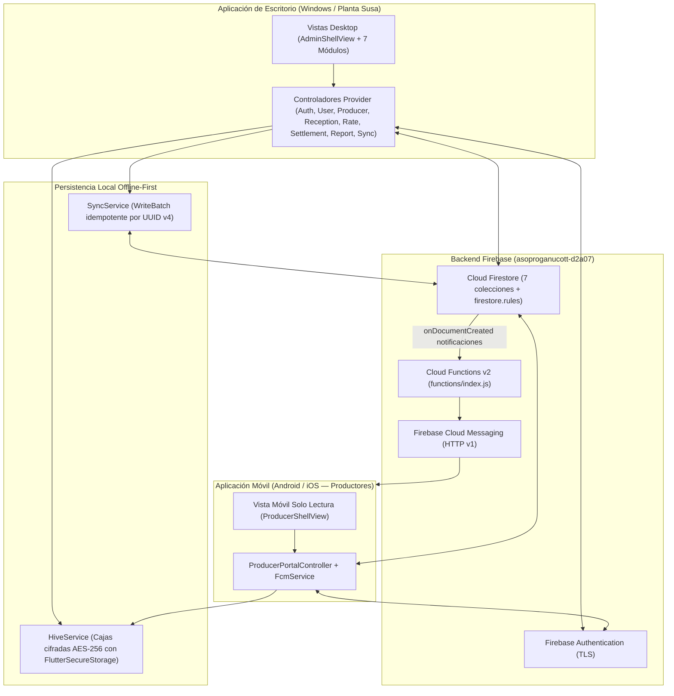

# Manual Técnico — Sistema ASOPROGANUCOTT (`CHK-08`)

> **Proyecto de grado:** *Sistema de registro y control de recepción de leche cruda para la asociación lechera ASOPROGANUCOT en el municipio de Susa (Valle de Ubaté, Cundinamarca)*  
> **Arquitectura:** Modelo–Vista–Controlador (`MVC`) · Cliente–Servidor · Offline-First (`Hive` AES-256 + `Firebase`)  
> **Proyecto Firebase:** `asoproganucott-d2a07` (Cloud Firestore `nam5`, Firebase Auth, Firebase Cloud Messaging HTTP v1)

---

## 1. Arquitectura General del Sistema



---

## 2. Estructura del Proyecto (`lib/`, `functions/`, `test/`)

### 2.1 Capa de Modelos (`lib/models/`)
- `user_model.dart`: `UserModel` (`uid`, `nombreCompleto`, `documento`, `correo`, `telefono`, `rol`, `activo`, `fcmTokens`, `fechaCreacion`, `ultimoAcceso`) con propiedades RBAC (`isAdmin`, `isOperario`, `isProductor`, `canAccessDesktopAdmin`).
- `producer_model.dart`: `ProducerModel` (`productorId`, `uidUsuario`, `codigoAsociado`, `cedula`, `nombres`, `apellidos`, `telefono`, `nombreFinca`, `vereda`, `estado`, `aceptoHabeasData`, `fechaAutorizacionDatos`, `autorizadoPorUid`).
- `milk_rate_model.dart`: `MilkRateModel` (tarifas históricas por vigencia sin sobrescritura de períodos cerrados).
- `milk_reception_model.dart`: `MilkReceptionModel` (`recepcionId` UUID v4, `litros`, `fechaEntrega`, `horaEntrega`, `jornada` `MANANA`/`TARDE`, `syncStatus`, `isSynced`, `liquidacionId`, `anulado`, `motivoAnulacion`).
- `settlement_model.dart`: `SettlementModel` (`liquidacionId`, `numeroComprobante`, `hashIntegridad`, `estadoPago`, `fechaPago`, `observacionPago`).
- `app_notification_model.dart`: `AppNotificationModel` (`ENTREGA`, `CIERRE_QUINCENA`, `LIQUIDACION`, `PAGO`, `COMUNICADO`, `RECTIFICACION`).
- `audit_log_model.dart`: `AuditLogModel` (bitácora inmutable `auditoria_logs`).

### 2.2 Capa de Servicios (`lib/core/services/`)
- `firebase_user_service.dart`: autenticación por correo o cédula (`signInWithIdentifier`), gestión CRUD y creación secundaria de cuentas sin cerrar sesión (`SecondaryUserCreator`).
- `hive_service.dart`: inicialización de cajas Hive y cifrado AES-256 (`HiveAesCipher`) respaldado en `FlutterSecureStorage`.
- `master_cache_service.dart`: sincronización local del padrón activo y tarifa vigente para operar 100% sin red.
- `sync_service.dart`: registro local prioritario (`registerReceptionOfflineFirst`) y subida idempotente por lotes (`WriteBatch`, `maxBatchSize = 400`).
- `producer_service.dart`: unicidad estricta de `cedula` y `codigoAsociado`, validación obligatoria Ley 1581 de 2012, vinculación automática con cuenta móvil y `findProducerForUser`.
- `reception_service.dart`: captura diaria, alerta de duplicados (`DuplicateReceptionException`), corrección/anulación auditada por `ADMIN`, bloqueo post-liquidación, alerta local `ENTREGA` y `listForProducer`.
- `rate_service.dart`: configuración de nuevas vigencias históricas de tarifa por litro.
- `settlement_calculator.dart`: motor determinista en punto fijo entero (`thousandths`, `rateCents`), consecutivo `COMP-YYYY-XXXX` y huella SHA-256 Ley 527 de 1999 (`computeIntegrityHash`).
- `settlement_service.dart`: cierre quincenal atómico y confirmación de pago `PENDIENTE -> PAGADA`.
- `settlement_pdf_service.dart`: comprobantes internos de pago en PDF.
- `report_service.dart` y `report_export_service.dart`: estadísticas consolidadas, bitácora `auditoria_logs`, CSV UTF-8 con BOM y PDF administrativo.
- `notification_service.dart`: bandeja móvil aislada, comunicados institucionales (`COMUNICADO`) y solicitudes de rectificación Ley 1581 de 2012 (`RECTIFICACION`).
- `fcm_service.dart`: encapsulamiento seguro por plataforma (`!kIsWeb && (Platform.isAndroid || Platform.isIOS)`) con soporte de suscripción a tópicos y escucha en primer plano.

### 2.3 Capa de Controladores (`lib/controllers/`)
- `auth_controller.dart`, `user_controller.dart`, `sync_controller.dart`, `producer_controller.dart`, `reception_controller.dart`, `rate_controller.dart`, `settlement_controller.dart`, `report_controller.dart`, `producer_portal_controller.dart`.

### 2.4 Capa de Vistas (`lib/views/`)
- `shared/`: `login_view.dart` (escritorio 2 columnas con `CowBalloon3DWidget` + móvil `ModernWaveHeader`), `widgets/dairy_loader.dart` (`DairyLoader`, `AsoproganucotCurtain`), `widgets/design_system_widgets.dart`.
- `desktop/`: `admin_shell_view.dart`, `dashboard_module_view.dart`, `reception_module_view.dart`, `producers_module_view.dart`, `settlements_module_view.dart`, `rates_module_view.dart`, `reports_module_view.dart`, `users_module_view.dart`.
- `mobile/`: `producer_shell_view.dart` (`Resumen`, `Mis Entregas`, `Liquidaciones y Avisos`, perfil + rectificación Ley 1581).

---

## 3. Modelo de Datos en Cloud Firestore y Hive Offline

### 3.1 Colecciones Cloud Firestore y Reglas (`firestore.rules`)

| Colección | Control de Acceso (`firestore.rules`) | Regla de Integridad / Inmutabilidad |
| :--- | :--- | :--- |
| `usuarios` | Lectura del perfil propio y acceso administrativo. El propietario puede actualizar sus tokens de notificación y registrar su inicio de sesión. La autenticación por cédula se resuelve en `signInByDocument`. | Eliminación bloqueada desde clientes. |
| `productores` | Lectura `ADMIN`/`OPERARIO` o `uidUsuario == request.auth.uid`; escritura solo `ADMIN`. | Exige `aceptoHabeasData == true` (`Ley 1581/2012`). |
| `tarifas_leche` | Lectura autenticada; creación/ajuste solo `ADMIN`. | Precio, fecha de inicio y creador inmutables tras crear. |
| `recepciones_leche` | Lectura `ADMIN`/`OPERARIO` o productor propietario (`isProducerOwner`); escritura `ADMIN`/`OPERARIO`. | Bloqueo total de edición una vez `liquidacionId != null` (`RNF-06`). |
| `liquidaciones` | Lectura `ADMIN`/`OPERARIO` o productor propietario (`isProducerOwner`); creación solo `ADMIN`. | Montos y totales inmutables; `ADMIN` solo transiciona `PENDIENTE -> PAGADA`. |
| `notificaciones` | Lectura `ADMIN`/`OPERARIO` o avisos del propio productor / comunicados generales (`null`). | Productor solo puede crear `RECTIFICACION` y actualizar el campo `leida`. |
| `auditoria_logs` | Consulta por `ADMIN`. Las reglas validan el actor y vinculan los eventos de afiliación, entregas, pagos e inicios de sesión a sus transacciones. | Los clientes solo pueden añadir los eventos autorizados. |

### 3.2 Índices Compuestos (`firestore.indexes.json`)
- `recepciones_leche`: `(productorId ASC, fechaEntrega DESC)` y `(liquidacionId ASC, fechaEntrega ASC)`.
- `liquidaciones`: `(productorId ASC, fechaLiquidacion DESC)` y `(estadoPago ASC, fechaLiquidacion DESC)`.
- `notificaciones`: `(destinoProductorId ASC, fechaEnvio DESC)`.

### 3.3 Cajas Locales Hive (`AppConstants`)
- Cajas sin cifrado de sesión/usuarios: `users_box`, `session_box`.
- Cajas cifradas AES-256 (`HiveAesCipher`): `deliveries_box`, `producers_box`, `rates_box`, `settlements_box`, `notifications_box`.

---

## 4. Fuentes Locales y Recursos Offline
- Tipografía oficial **`Inter`** empaquetada localmente en `assets/fonts/` (`Inter-Regular.ttf` 400, `Inter-Medium.ttf` 500, `Inter-SemiBold.ttf` 600, `Inter-Bold.ttf` 700, `Inter-ExtraBold.ttf` 800) y declarada en `pubspec.yaml` con `GoogleFonts.config.allowRuntimeFetching = false;` en `lib/main.dart`.
- Logotipo oficial circular en `assets/images/` e íconos nativos generados para Android, iOS, macOS, Web y Windows.
- Modelo 3D GLB en `assets/models/spot_holstein_cow.glb`.

---

## 5. Cloud Functions FCM HTTP v1 (`functions/`)
El archivo `functions/index.js` define el disparador `onNotificationCreated` sobre `notificaciones/{notificacionId}` para enviar notificaciones push mediante FCM HTTP v1 ante los eventos: `ENTREGA`, `CIERRE_QUINCENA`, `LIQUIDACION`, `PAGO` y `COMUNICADO`.

```bash
# Instalación y despliegue de reglas, índices y funciones en Firebase
firebase deploy --only firestore:rules,firestore:indexes
cd functions && npm install && cd ..
firebase deploy --only functions
```

---

## 6. Comandos de Compilación, Análisis y CI
- **Análisis estático:** `flutter analyze` (`0` advertencias/errores exigidos).
- **Suite de pruebas XP:** `flutter test` (`test/unit/` y `test/widget_test.dart`).
- **Ejecución Windows Desktop:** `flutter run -d windows`.
- **Compilación Android APK:** `flutter build apk --release`.
- **Integración Continua:** automatizada en `.github/workflows/flutter_ci.yml`.

## Conservación de registros y protección de datos personales

### Entregas, liquidaciones y consulta de auditoría

- Firestore conserva los registros en su formato nativo, con sus identificadores, campos y tipos de datos. La recepción guarda `operarioUid`, `createdAt` y la hora de entrega. Las modificaciones posteriores llevan `updatedAt` con hora del servidor, `updatedByUid` y `auditLogId`. En una captura sin conexión, la hora de captura y la de ingreso al servidor pueden ser distintas. La asociación debe sincronizar antes de liquidar.
- Cada registro nuevo y cada rectificación o anulación de una entrega quedan en una transacción con su evento de auditoría. La bitácora conserva la versión anterior y la registrada, el actor y, en las correcciones y anulaciones, el motivo. La corrección requiere que la entrega ya esté sincronizada y que la aplicación esté en línea. Las entregas liquidadas quedan bloqueadas.
- El cierre valida las entregas y el cálculo en el servidor. Cada comprobante se confirma con el vínculo a sus entregas, las versiones de auditoría y la notificación dentro de una transacción por productor. Si se interrumpe un cierre general, vuelve a cargar el módulo para ver cuáles comprobantes se confirmaron antes de reintentar. Los pagos quedan registrados con su propio evento. Los comprobantes PDF se generan desde los registros conservados.
- En **Reportes y Auditoría**, selecciona un ID de registro o escribe el ID completo y pulsa el icono de historial. La consulta carga todas sus versiones registradas, incluidas las que quedaron fuera de la vista de eventos recientes. La operación recupera eventos históricos existentes. Una modificación anterior que nunca dejó un evento no puede reconstruirse con certeza.
- El artículo 12 de la Ley 527 admite el formato original o uno que demuestre reproducción exacta. También exige accesibilidad y la conservación de los datos disponibles de origen, destino, fecha y hora. La asociación debe definir sus plazos de archivo y conservar por separado el registro anterior en papel, o su reproducción verificable, cuando aplique. [Ley 527 de 1999, artículos 8, 9 y 12](https://forseti.defensoria.gov.co/gestor/compilacion/docs/ley_0527_1999.htm)

### Aviso de privacidad y autorización del productor

Antes de habilitar nuevas afiliaciones, la asociación debe publicar su política aprobada y registrar un documento de Firestore en `configuracion/privacidad`. Usa exactamente estos ocho campos de tipo texto. Los valores institucionales deben validarse con la asociación.

| Campo | Contenido |
| --- | --- |
| `version` | Identificador de la versión aprobada y su fecha de vigencia. |
| `responsable` | Nombre jurídico de la asociación responsable del tratamiento. |
| `direccion` | Dirección oficial para la atención de los titulares. |
| `correo` y `telefono` | Canales institucionales de atención. |
| `politicaUrl` | URL HTTPS de la política de tratamiento aprobada, accesible a los titulares. |
| `finalidades` | Texto aprobado. Puede describir el registro y la administración de entregas, el cálculo y registro de pagos, la emisión de comprobantes y la consulta del historial del productor. |
| `derechos` | Texto aprobado que explique cómo acceder gratuitamente a sus datos, actualizarlos o rectificarlos, solicitar prueba de autorización o información de uso, presentar quejas ante la SIC y pedir revocatoria o supresión cuando proceda. Si se solicitan datos sensibles, informa expresamente el carácter facultativo de responder. |

El administrador entrega el aviso y obtiene la autorización antes de registrar los datos personales. Conserva el soporte original firmado o electrónico en el archivo de acceso restringido. En el formulario ingresa una referencia interna consultable, sin copiar el documento de identidad ni publicar el soporte. El sistema conserva la referencia, una copia del aviso mostrado, la fecha de registro y el UID del administrador. Conserva las versiones previas del aviso y de la política en el archivo institucional. Verifica el soporte de afiliaciones históricas y regulariza su evidencia por el proceso institucional.

El productor vinculado consulta su perfil, su historial de entregas y sus liquidaciones en la aplicación móvil. También puede abrir el aviso y enviar solicitudes de rectificación. Los demás derechos se atienden por los canales institucionales descritos en el aviso. [Ley 1581 de 2012, artículos 4, 8, 9, 12, 14 y 17](https://normativa.archivogeneral.gov.co/ley-estatutaria-1581-de-2012/) · [Decreto 1377 de 2013, artículos 14 a 16, compilados en los artículos 2.2.2.25.3.2 a 2.2.2.25.3.4 del Decreto 1074 de 2015](https://www.cancilleria.gov.co/normograma/compilacion/docs/decreto_1377_2013.htm)

### Alta digital en el portal del productor

- El administrador genera un enlace desde **Productores** y lo entrega al titular por un canal privado. El enlace tiene un solo uso y vence en 48 horas. El productor lo abre en el navegador o lo pega en **Crear cuenta de productor** en la app, consulta la política y acepta antes de crear su contraseña. El documento y el celular deben coincidir con el productor activo del padrón al que pertenece el enlace.
- `registerProducerAccount` vincula la cuenta al productor del padrón y registra la declaración que aceptó el productor, el aviso y su versión, la fecha de servidor y el canal `PORTAL_ENLACE` en `autorizaciones_portal/{uid}`. La vinculación queda como `VINCULAR_PORTAL` en la bitácora. El inicio de sesión usa documento y contraseña. Firebase Auth conserva la contraseña como hash y el alias interno solo permite resolver el ingreso por documento.
- La aceptación del portal cubre la activación y consulta en la app. Al incorporar datos al padrón, la asociación conserva la evidencia consultable de la autorización previa o de la excepción legal aplicable. Esta evidencia puede obtenerse electrónicamente. [Ley 1581 de 2012, artículos 9 y 10](https://normativa.archivogeneral.gov.co/ley-estatutaria-1581-de-2012/)
- Completa y adopta el [formato de política y aviso](privacidad/politica-y-aviso-asoproganucot.pdf). Conserva el original firmado en el archivo institucional de acceso restringido. Sube una copia de divulgación aprobada a una ruta versionada de Firebase Storage, copia su URL HTTPS en `politicaUrl` y publica los ocho campos en `configuracion/privacidad`. El botón **Ver política de tratamiento** abre esa URL. El documento público contiene datos institucionales. Los soportes y las aceptaciones se archivan con acceso restringido.
- Habilita el proveedor de correo y contraseña en Firebase Authentication. Publica las funciones y reglas junto con la ruta web de activación en Firebase Hosting. Para probar el backend en local con Authentication y Firestore usa `firebase emulators:exec --only auth,firestore --project demo-asoproganucot "node --test functions/test/compliance.test.js"`.

### Activación en Firebase y recuperación

1. Configura `AUTH_WEB_API_KEY` para Cloud Functions con la clave web del proyecto habilitada para Identity Toolkit. Verifica que la cuenta de servicio de `signInByDocument` pueda firmar los tokens personalizados mediante `iam.serviceAccounts.signBlob`. Las contraseñas las verifica Firebase Auth y se conservan como hashes de Firebase Auth. Los perfiles de Firestore y la caché de la aplicación no guardan contraseñas. [Inicio por contraseña](https://docs.cloud.google.com/identity-platform/docs/reference/rest/v1/accounts/signInWithPassword) · [Tokens personalizados](https://docs.cloud.google.com/identity-platform/docs/admin/create-custom-tokens) · [Hashes de Firebase Auth](https://firebase.google.com/docs/auth/admin/import-users)
2. Publica las funciones, reglas e índices con `firebase deploy --only functions,firestore --project ID_DEL_PROYECTO`. Coordina esta publicación con la actualización de los clientes. Verifica con cuentas de cada rol el login por correo y cédula, el alta con aviso, la entrega sin conexión y posterior sincronización bajo la cuenta que la capturó, el cierre, el pago y la consulta aislada del productor.
3. En Google Cloud, programa un respaldo diario de Firestore. Define la retención operativa según la capacidad de recuperación acordada con la asociación. Por ejemplo, para una ventana de 28 días:

   ```powershell
   gcloud firestore backups schedules create --project=ID_DEL_PROYECTO --database='(default)' --recurrence=daily --retention=28d
   gcloud firestore backups schedules list --project=ID_DEL_PROYECTO --database='(default)'
   ```

   Verifica que se genere el primer respaldo y prueba su restauración en una base separada. El respaldo de Firestore abarca registros e índices de esa base. Documenta por separado la recuperación de cuentas de Firebase Auth y el resguardo del archivo de autorizaciones. La retención del respaldo diario y el plazo de conservación documental cumplen propósitos distintos. [Respaldos y restauración de Firestore](https://firebase.google.com/docs/firestore/backups)
4. Habilita y verifica **Data Access** para la API de Firestore/Datastore en **IAM y administración → Registros de auditoría**. Comprueba en Logs Explorer las operaciones y principales que reporta Google Cloud. La bitácora de la app registra cada nuevo inicio de sesión confirmado con UID y hora del servidor. Las reglas limitan el acceso de los productores a su perfil, sus entregas y sus liquidaciones. [Registros de auditoría de Firestore](https://docs.cloud.google.com/firestore/native/docs/audit-logging)

Para probar las reglas y el cierre contra un emulador local, ejecuta desde la raíz `firebase emulators:exec --only firestore --project demo-asoproganucot "node --test functions/test/compliance.test.js"` con las dependencias de `functions` instaladas.
