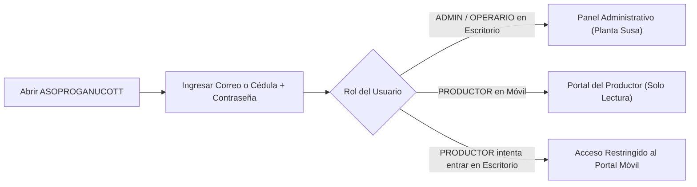

# Manual de Usuario — Plataforma ASOPROGANUCOTT (`CHK-08`)

> **Asociación de Productores y Ganaderos — Susa, Valle de Ubaté, Cundinamarca**  
> Guía práctica paso a paso para los tres perfiles oficiales del sistema: **Administrador Central**, **Operario de Recepción en Planta** y **Productor Ganadero (App Móvil)**.

---

## 1. Inicio de Sesión (Escritorio y Móvil)

1. Escribe tu **correo institucional** o tu **número de cédula** en el primer campo y tu **contraseña**.
2. Marca **Recordar acceso** si deseas conservar tu identificador para el próximo ingreso.
3. Si olvidaste tu contraseña, presiona **¿Olvidaste tu contraseña?** para recibir un enlace de recuperación por correo electrónico.

---

## 2. Operación en Planta — Operario de Recepción (Escritorio)

El Operario de Recepción tiene acceso optimizado al módulo de **Inicio**, **Recepción de Leche** y consulta de **Productores**.

### 2.1 Cómo registrar entregas de leche en `< 10 segundos` (100% Teclado)
1. En el menú lateral verde oscuro, haz clic en **Recepción de Leche**.
2. En el campo **1. Productor (código, cédula o nombre)** escribe el código del ganadero (ej. `ASO-001`), cédula o nombre y presiona **Enter** (o selecciónalo de la lista).
3. Confirma la jornada (**Mañana** o **Tarde** — se preselecciona automáticamente según la hora del día).
4. Digita los **Litros** recibidos (admite decimales como `32.5`) y presiona **Enter**.
5. El sistema guarda el registro al instante en la base local cifrada (**Hive**):
   - Si hay internet, muestra badge verde **Sincronizado** y envía alerta automática al productor.
   - Si no hay internet en la planta, muestra **Sin conexión / Pendiente** y guarda el registro sin interrumpir la fila. Al volver la señal, presiona **Sincronizar** o espera la subida automática.
6. **Alerta de duplicado:** Si el mismo ganadero ya tiene una entrega registrada en ese mismo turno y fecha, aparecerá una ventana preguntando si deseas confirmar una segunda entrega en el turno.

---

## 3. Gestión Integral — Administrador Central (Escritorio)

El **Administrador Central** cuenta con los 7 módulos del panel izquierdo más el emisor de comunicados en la barra superior:

### 3.1 Productores y Habeas Data (Ley 1581 de 2012)
1. Ingresa a **Productores** y presiona **Nuevo productor**.
2. Entrega al productor el aviso de privacidad vigente y obtén su autorización previa. Confirma ambas acciones en el formulario e ingresa la referencia del soporte firmado o electrónico que conserva la asociación. Luego completa los datos del productor.
3. Registra el celular personal del productor. Desde la app móvil podrá activar su cuenta con su documento y el mismo celular. La vinculación manual sigue disponible para cuentas anteriores o casos de soporte.
4. Puedes editar datos o cambiar el estado entre `ACTIVO` e `INACTIVO` sin perder el historial de entregas.

### 3.2 Corrección o Anulación Auditada de Entregas
1. Con la aplicación en línea, ubica una entrega sincronizada y pendiente de liquidación en **Recepción de Leche**.
2. Usa **Corregir litros** o **Anular** escribiendo obligatoriamente el motivo de auditoría (mínimo 5 caracteres). El cambio queda trazado en la bitácora `auditoria_logs`.
3. Una vez la entrega está liquidada, el candado normativo (**Ley 527 de 1999**) bloquea toda modificación.

### 3.3 Tarifas por Litro y Liquidación Quincenal
1. **Tarifas por Litro:** Presiona **Nueva tarifa vigente**, ingresa el valor en pesos por litro, la fecha de inicio y observación. Las tarifas anteriores permanecen intactas como respaldo histórico.
2. **Liquidaciones:** Selecciona el rango quincenal (**1ª quincena días 1–15** o **2ª quincena días 16–fin de mes**), verifica el listado preliminar (litros mañana, litros tarde, tarifa y total a pagar) y presiona **Ejecutar cierre quincenal**.
3. **Comprobantes PDF y Pago:** Descarga/imprime el comprobante PDF individual numerado (`COMP-YYYY-XXXX`) con sello SHA-256. Cuando realices el pago por fuera del sistema, presiona **Confirmar pago**, escribe la referencia (ej. transferencia o efectivo) y el productor recibirá notificación automática.

### 3.4 Reportes, Auditoría y Comunicados
- **Reportes y Auditoría:** Consulta producción por ganadero, promedio diario, auditoría inmutable y exporta en **CSV** (compatible con Excel en español) o **PDF consolidado**.
- **Comunicados Institucionales:** En la barra superior derecha presiona **Comunicados** para enviar avisos masivos a todos los productores o a un asociado puntual.
- **Usuarios:** Crea, edita, activa/suspende cuentas `ADMIN`, `OPERARIO` o `PRODUCTOR` y envía restablecimiento de contraseña.

---

## 4. Portal Móvil del Productor / Ganadero (Android / iOS)

Si ya estás en el padrón, toca **Crear cuenta de productor** en el inicio de sesión. Abre la política y confirma la autorización. Ingresa el documento y celular registrados en la asociación, confirma el código que recibas por SMS y escribe dos veces tu nueva contraseña. Luego ingresa con tu número de documento y contraseña.

> El portal móvil es **estrictamente de solo lectura** para entregas y pagos, diseñado con letras claras (`>= 15px`) para lectura cómoda al aire libre en finca.

1. **Pestaña 1 — Resumen:** Muestra tus litros acumulados en la quincena actual, el estimado económico proyectado según tarifa vigente, acumulado y promedio del mes, tu último pago, un gráfico de los últimos 7 días (Mañana vs. Tarde) y botones directos de acceso en máximo 2 toques.
2. **Pestaña 2 — Mis Entregas:** Consulta todas tus entregas en orden cronológico con fecha, hora exacta, jornada (**MAÑANA** / **TARDE**), litros y estado (`Liquidada` / `En quincena`), con filtros por quincena, mes, fecha o jornada.
3. **Pestaña 3 — Liquidaciones y Avisos:**
   - **Comprobantes:** Revisa cada quincena cerrada, tarifa aplicada, valor total, estado (`PENDIENTE` o `PAGADA` con fecha) y toca **Ver PDF** o **Descargar** para guardar o compartir tu comprobante.
   - **Avisos:** Lee alertas automáticas de cada entrega, cierre quincenal, confirmación de pago y comunicados generales de ASOPROGANUCOTT, con filtro de **No leídas**.
4. **Mi Perfil y Habeas Data (Ley 1581 de 2012):** Toca el ícono de perfil arriba a la derecha para revisar tu código de asociado, finca, vereda y enviar una **Solicitud de rectificación de datos personales** al Administrador.
